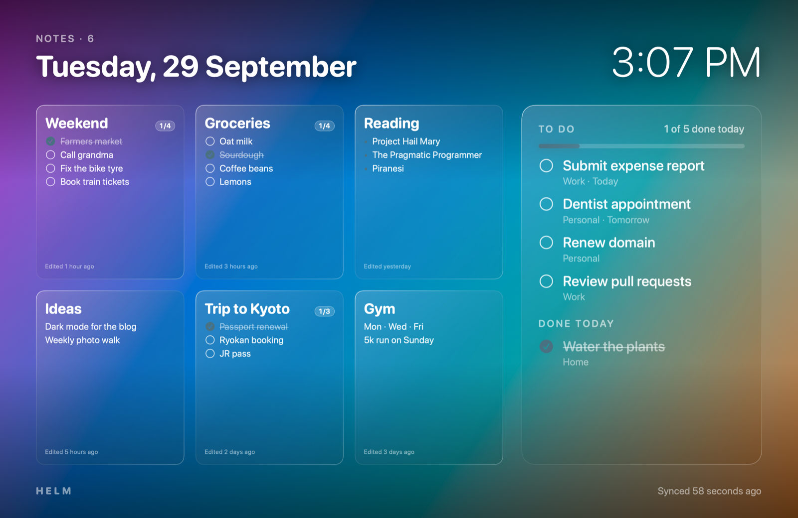

# helm

A macOS screensaver that shows your Apple Notes and Reminders on frosted glass
over a Ken Burns photo slideshow, with a menu bar app that keeps it in sync.



## Install

```sh
brew install --cask jonathanvineet/tap/helm
```

(Plain `brew install helm` installs the unrelated Kubernetes tool.)

Then:

1. **Open Helm.** It lives in the menu bar and starts at login.
2. **System Settings → Screen Saver:** pick Helm.
3. **Grant access** to Reminders, and Full Disk Access so Helm can read Apple Notes.

Helm isn't notarized yet, so the cask clears macOS's download quarantine flag from the app, and the app clears it from the screensaver when it launches.

## Build from source

Build dependencies (end users do not need these):

```sh
brew install tesseract
python3 -m venv api/.venv
api/.venv/bin/python -m pip install -r api/requirements-build.txt
```

```sh
./build.sh --install
```

## Print quotations

Choose **Print Quote…** from Helm's menu bar to choose, paste, or capture a Creality Print
estimate screenshot, review OCR readings, and calculate an INR quote with editable
rates. Capture Screen hides Helm while you select the estimate area or window.
Python and Tesseract are bundled inside Helm; no terminal, server, or separate
installation is needed. Images stay on your Mac. See [`api/README.md`](api/README.md)
for the developer API, packaging, and tests.

## Watching pages

Helm's browser extension (in [`extension/`](extension/)) watches pages you're
waiting on, like an order, an app review or a visa status, and tells you when
they change. It runs in your normal browser, so pages you're logged in to work.

**Install.** In Brave, open `brave://extensions`, turn on Developer mode, click
Load unpacked and choose the `extension` folder. Then pin the Helm icon.

**Adding a watch.** Select the status text on the page, then click the Helm icon
and choose what to watch for:

- *The selected part changes* (the default) follows that text through every
  stage, like "Arriving Thursday" → "Out for delivery" → "Delivered".
- *Some text disappears from the page* waits for "still waiting" text to go
  away. Separate alternatives with `|`.

Under More options you can say what counts as done (like `Delivered`), limit a
text watch to the part of the page below a heading, and give slow pages longer
to load.

**Helm understands what it's watching.** When you add a watch, Helm works out
what kind of thing it is from the site, the address and the wording, and shows
it in the popup (you can change it): a delivery, an app review, an access
request, a visa or government application, a job application, results or
admission, a booking or waitlist, a refund or claim, a support ticket, a build,
or a product's price and stock. Anything else is watched as general text.

Knowing the kind, Helm reads the status like a person would:

- which step it's at (📦 Ordered → Shipped → On the way → Out for delivery →
  Delivered), shown as a progress bar in the popup and on the screensaver
- when it's finished, without you typing a "done" phrase
- when something went wrong (rejected, delivery failed, build failed) or it's
  waiting on you (more documents needed, awaiting your reply)
- delivery dates, prices and waitlist positions, and ignores wording like
  "not delivered yet"

It only tells you about changes that mean something: a new stage, an outcome,
a new date, a price drop or a waitlist move, and not "updated 5 min ago"
ticking over. Alerts say what happened, like "📦 Out for delivery (was On the
way)" or "Price dropped from ₹1,999 to ₹1,499". All of this runs in the
extension; page text never leaves your browser.

**Examples.**

- Amazon order: open the order details or Track package page (not the order
  list, which reshuffles), select the delivery status, and watch for changes.
  Mark as done when it says `Delivered`.
- Play Console app review: choose *some text disappears* with `Changes in review`.
- LinkedIn API product: select "Review in progress" and watch for changes.

**Checking at the right pace.** Each watch is checked when it's due: every
5 minutes when it's one step from done (out for delivery) or due within a few
hours, at your chosen interval while it's moving, less often when nothing has
changed for days, and not at all once it's finished (Check now still looks).
Switching to or reloading a watched page's tab checks it on the spot. The popup
says when the next check is and why a watch is checked more or less often.

**Watches that repair themselves.** Helm remembers the label next to the status
you selected. If the site is redesigned and the status moves, Helm finds it
again by its last text, by sitting just after that label, or by wording that
fits what it's watching, and carries on. The popup notes "found again after the
page changed". Only if none of that works does it report "(no longer on the page)".

**On the screensaver.** Watches also appear in the board's Waiting on panel.
Helm.app registers itself with Brave and Chrome at launch, and the extension
hands it the watch list (over native messaging, which stays on your Mac)
whenever something changes. The board shows a live countdown when Helm knows
when something is due ("in about 3 h", "tomorrow"), celebrates for a few hours
when something finishes, and drops finished watches after 3 days. Turn the
panel off in Customize → Watched pages.

**Mac notifications and the menu bar.** Alerts also arrive as Mac notifications
from Helm (click one to open the page), even when Brave isn't in front; turn
them off in Customize → Watched pages. Helm's menu bar icon shows how many
watches need you, and its menu lists them all; choose one to open it.

**Badge.** Green shows how many watches have news for you: an update you haven't
seen, a problem, or a finished review. Otherwise amber shows how many are still
being watched. Opening the popup marks updates as seen.

**Phone alerts.** Install the [ntfy](https://ntfy.sh) app, subscribe to a topic
that's hard to guess, and enter the same topic under Settings → Phone alerts.
Send test checks it works. This is the extension's only network request.

**Limits.**

- The browser has to be running for checks to happen.
- Pages you already have open are checked in their tab, which reloads in the
  background (unless it's the tab you're looking at). Pages that aren't open
  are loaded in a minimized window that closes when the check is done.
- A site redesign can break a selected-text watch. It then shows "(no longer on
  the page)"; add the watch again.
- Don't select text that changes by itself, like "updated 5 min ago".
- Keep the interval at 30 minutes or more.

**Tests** (dev only):

```sh
cd tests/extension && npm install && npx playwright install chromium && npm test   # unit + browser tests
```

## Screenshot

`docs/screenshot.png` is drawn from the demo board, not your own notes:

```sh
build/helm-render docs/screenshot.png 5 "" docs/demo-board.json
```

Pass a photo path instead of `""` to render over a photo.

## Release

Push a version tag:

```sh
git tag v0.4.0 && git push origin v0.4.0
```

The Release workflow (`.github/workflows/release.yml`) builds the OCR helper on
Apple silicon and Intel runners, runs `release.sh`, publishes
`Helm-0.4.0.zip` to a GitHub release, and updates `Casks/helm.rb` in
[jonathanvineet/homebrew-tap](https://github.com/jonathanvineet/homebrew-tap)
(set a `TAP_TOKEN` secret that can push to the tap).

Installed copies pick it up from **Check for Updates…** in the menu bar. Helm
also checks once a day and shows "Update to Helm 0.4.0…" when one is out. It
verifies the download against GitHub's checksum, replaces Helm.app and
Helm.saver in place, and relaunches.

To package by hand instead, `./release.sh 0.4.0` writes `dist/Helm-0.4.0.zip`
and `dist/helm.rb`.
